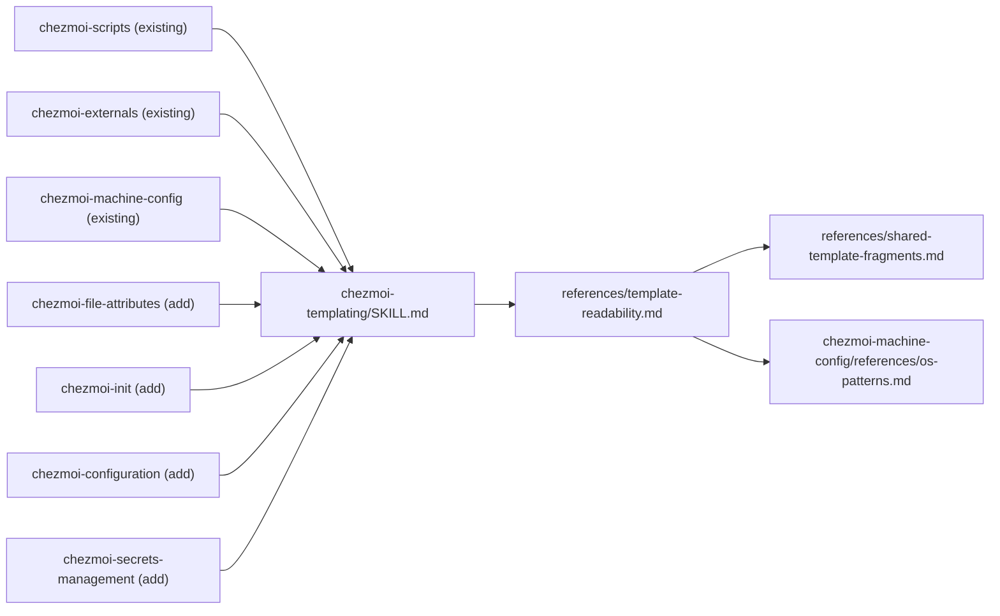

# Template readability reference guide

- **Author:** Mike Kobit
- **Status:** Proposed
- **Date:** 2026-11-22

--------------------------------------------------------------------------------

## Overview

This design adds a template readability reference guide at `skills/chezmoi-templating/references/template-readability.md` and adds skill-level pointers to `chezmoi-templating` from template-producing skills that currently lack them.
The guide gives AI agents advisory heuristics for writing and refactoring Go `text/template` code used by chezmoi: extracting local variables to flatten nested conditional chains, applying directional whitespace trimming, writing short `why` comments, and formatting multi-stage pipelines.
Paired `answer_quality` evaluation cases in `tests/evals/templating_eval.json` verify that agents apply these heuristics on multi-condition templates without mandating variable extraction on single-condition checks.

## The problem

Chezmoi templates use Go `text/template` prefix notation (`and`, `or`, `not`, `eq`, `dig`, `kindIs`), which becomes hard to scan when multiple conditions are nested inline.
Because chezmoi templates wrap arbitrary target formats (shell scripts, `modify_` scripts, JSON, TOML, YAML, `.chezmoiexternal`, `.chezmoiignore`), generic auto-formatters cannot format them safely.
Without explicit readability heuristics, agents can emit dense inline conditional chains (for example, `{{- if and (or (eq $head "sbx") (hasPrefix "sbx " $head)) (has $action (list "allow" "prompt" "deny")) -}}`) or omit whitespace trims on helper lines.
In addition, four template-producing skills (`chezmoi-file-attributes`, `chezmoi-init`, `chezmoi-configuration`, and `chezmoi-secrets-management`) currently lack a `## Related skills` pointer to `chezmoi-templating`.

## Goals

- Provide example-driven readability heuristics in `skills/chezmoi-templating/references/template-readability.md` (`<= 1500` tokens, single-sentence-per-line prose) covering local variable extraction, Go `text/template` block scoping (`:=` vs. `=`), guard-safety, directional whitespace trimming, short `{{/* ... */}}` comments, and pipeline readability.
- Ensure agents can reach `chezmoi-templating` (2-hop discovery: sibling `SKILL.md` -> `chezmoi-templating/SKILL.md` -> `references/template-readability.md`) from all template-producing skills (`chezmoi-scripts`, `chezmoi-externals`, `chezmoi-machine-config`, `chezmoi-file-attributes`, `chezmoi-init`, `chezmoi-configuration`, and `chezmoi-secrets-management`), keeping every modified `SKILL.md` body within the 600-token ceiling.
- Add paired `answer_quality` eval cases (`TC-TPL-ANS-001` and `TC-TPL-ANS-002`) to `tests/evals/templating_eval.json` verifying that agents extract intermediate variables for 3+ nested conditions and avoid mandating variable extraction on single-condition checks.

## Non-goals

- Creating a new standalone top-level skill for template style.
- Building or integrating a custom template linter or auto-formatter.
- Enforcing rigid operator-count or line-length rules that force variable extraction on single-condition checks (such as `{{ if eq .chezmoi.os "darwin" }}`).
- Adding cross-skill `tests/evals/` cases or deep-linking `references/` subpaths from sibling `SKILL.md` files.

## Critical user journeys (CUJs)

### CUJ 1: Refactoring or authoring a multi-condition template

- **Given:** An agent loads `chezmoi-templating`, or loads a sibling template-producing skill and follows its `## Related skills` pointer to `chezmoi-templating`, to write a template with 3+ nested conditions.
- **When:** The agent follows `## Reference guides` in `chezmoi-templating/SKILL.md` and reads `skills/chezmoi-templating/references/template-readability.md`.
- **Then:** The agent extracts descriptive local variables before the branch using `{{- $var := ... -}}`, adds a short `{{- /* ... */ -}}` comment if the intent is non-obvious, and produces valid Go `text/template` output without stray blank lines or collapsed output lines.

### CUJ 2: Keeping a single-condition check inline

- **Given:** An agent writes a template containing a single-condition check (such as `{{ if eq .chezmoi.os "darwin" }}`).
- **When:** The agent applies the advisory heuristics in `template-readability.md`.
- **Then:** The agent keeps the single check inline without extracting intermediate variables or adding comments.

## Technical plan (architecture)

### 1. Progressive disclosure in `chezmoi-templating`

Place all readability heuristics and examples inside `skills/chezmoi-templating/references/template-readability.md` (body `<= 1500` tokens, single-sentence-per-line prose) rather than in `skills/chezmoi-templating/SKILL.md` (body `<= 600` tokens).
`SKILL.md` adds a single entry under `## Reference guides` with explicit trigger terms (`complex boolean chains`, `whitespace trimming`, `comments`, `pipelines`, `readability`).

### 2. Core readability heuristics in `template-readability.md`

Organize the reference guide around four advisory heuristics with before/after `gotmpl` examples:

1. **Local variable extraction for conditional chains:**
   - Heuristic: Extract intermediate booleans (`{{- $isSbx := ... -}}`) when a condition nests 3 or more conditional or boolean functions/operators (`and`, `or`, `not`, `eq`, `dig`, `kindIs`) or spans beyond one line.
   - Restraint: Keep single-condition checks (`{{ if eq .chezmoi.os "darwin" }}`) inline.
   - Scoping and guard-safety: Explain Go `text/template` block scoping (`$var := ...` inside `if`, `range`, or `with` shadows outer variables, whereas `=` reassigns an outer variable), and warn against hoisting expressions that depend on an outer `if` or `with` guard (such as `output` or unguarded map indexing).
   - Cross-reference `skills/chezmoi-machine-config/references/os-patterns.md` for OS/distro variable-extraction and `=` reassignment patterns instead of duplicating them.
2. **Directional whitespace trimming:**
   - Use `{{- ... -}}` on standalone variable-assignment or comment lines when removing the entire line, and use one-sided trimming (such as `{{- if ... }}` or `{{/* ... */ -}}`) on `if`/`else`/`end` block tags that wrap output lines so adjacent output lines do not merge in shell scripts, `modify_` scripts, YAML, or TOML.
   - Recommend verifying rendered whitespace with `chezmoi execute-template` (piping rendered output to target tools like `jq`, `yq`, `shfmt`, or `shellcheck` when needed).
3. **Short comments:**
   - Use `{{- /* ... */ -}}` on standalone lines (or `{{/* ... */}}` inline) to explain *why* a non-obvious check exists, not *what* standard template functions do.
4. **Pipeline formatting and fragment boundary:**
   - Split multi-stage pipelines (4+ function calls) across multiple lines or intermediate variables instead of nesting them on one line.
   - Cross-reference `references/shared-template-fragments.md` (`.chezmoitemplates/`) for logic repeated across multiple files.

### 3. Cross-skill discovery

Leave the 3 skills that already link to `chezmoi-templating` (`chezmoi-scripts`, `chezmoi-externals`, `chezmoi-machine-config`) unchanged.
Add a skill-level `` `chezmoi-templating` `` bullet under `## Related skills` (using backticked skill names in prose, not relative Markdown links) to the 4 skills that lack it: `chezmoi-file-attributes`, `chezmoi-init`, `chezmoi-configuration`, and `chezmoi-secrets-management` (adding a `## Related skills` section to `chezmoi-secrets-management`).

### 4. Behavioral verification in `tests/evals/`

Add two `answer_quality` test cases to `tests/evals/templating_eval.json` (`TC-TPL-ANS-001` and `TC-TPL-ANS-002`, `token_budget` 300–500).
In this repository's eval harness, `answer_quality` cases specify `required_concepts` (phrases that must appear) and `forbidden_claims` (phrases that must not appear), evaluated by `answerQualityMatches` in `scripts/eval-assertions.cjs` via case-insensitive literal substring matching, while `selectReference` in `scripts/generate-promptfoo-evals.ts` injects the single highest-overlap reference file into `reference_context`.
PR CI runs `bun run eval:validate` (which regenerates and validates Promptfoo configs without live LLM credentials), while live LLM grading (`bun run eval:answers`) runs manually with credentials outside PR CI.

- **Positive refactoring case (`TC-TPL-ANS-001`):** Given a 3+ level nested `and (or ...)` condition, verify `required_concepts` for local variable extraction, whitespace control, and a short `{{/* ... */}}` comment.
- **Negative restraint case (`TC-TPL-ANS-002`):** Given a single-condition check (`eq .chezmoi.os "darwin"`) with prompt terms that route `selectReference` to `template-readability.md`, verify `forbidden_claims` using affirmative anti-pattern phrases (for example, `"you must extract"` or `"always extract"`) rather than bare concept names that would false-fail on negative advice.

### 5. Risks and mitigations

| Risk | Mitigation |
| :--- | :--- |
| Blanket `{{- ... -}}` on control tags merges adjacent output lines | Document directional trimming (`{{- ... }}` vs. `{{- ... -}}`) and test "after" snippets with `chezmoi execute-template` |
| `SKILL.md` (>600 tokens) or L3 (>1500 tokens) exceeds budget or fails prose checks | Keep examples compact, cross-reference `os-patterns.md`, and run `mise run validate` |
| `answer_quality` substring checks false-fail or `selectReference` picks the wrong file | Use affirmative anti-pattern substrings in `forbidden_claims` and verify generated config via `bun run eval:validate` |

## Alternatives considered

### Alternative A: New standalone template-style skill

- **Pros:** Gives template readability its own top-level `SKILL.md` name and description, independent of `chezmoi-templating`.
- **Cons:** Increases skill discovery overhead and splits triggers already owned by `chezmoi-templating`; an agent writing a `.tmpl` file already loads `chezmoi-templating` and could skip a separate style skill.
- **Reason for rejection:** A reference file inside `chezmoi-templating` with skill-level links from missing sibling skills is sufficient without adding another top-level skill.

### Alternative B: Hard formatting rules or auto-formatter

- **Pros:** Deterministic enforcement via CLI formatting or strict lint rules on line length and operator counts.
- **Cons:** Generic auto-formatters cannot safely parse mixed template/target files, and hard operator-count bans force unnecessary variables on single-condition checks.
- **Reason for rejection:** Target-format safety is better preserved by advisory heuristics plus piping `chezmoi execute-template` output to target validators (`jq`, `yq`, `shfmt`, `shellcheck`).

### Alternative C: Static lint checks only (no behavioral evals)

- **Pros:** Zero LLM token cost and faster test maintenance without updating `tests/evals/`.
- **Cons:** Markdownlint, `cspell`, and skill-structure validators cannot verify whether an agent applies variable extraction, whitespace trimming, or restraint on simple checks.
- **Reason for rejection:** Paired `answer_quality` eval cases in `tests/evals/templating_eval.json` verify agent judgment in manual runs while `bun run eval:validate` keeps PR CI credential-free.

## Detailed implementation plan

Execute all edits in a dedicated Git worktree branched from `main`.
Verify token headroom (`<= 600` tokens for `SKILL.md` bodies, `<= 1500` tokens for L3 reference bodies) and single-sentence-per-line formatting across all edited files.

### Target files to create or modify

#### 1. `skills/chezmoi-templating/references/template-readability.md` (Create)

- **Type / scope:** L3 skill reference documentation (Markdown, body `<= 1500` tokens, one sentence per line).
- **Proposed changes:** Implement the four heuristics, scoping/guard-safety notes, `os-patterns.md` cross-reference, and self-contained before/after `gotmpl` examples specified in **Technical plan §2**.

#### 2. `skills/chezmoi-templating/SKILL.md` (Modify)

- **Type / scope:** Skill entrypoint (Markdown, body `<= 600` tokens).
- **Proposed changes:** Add `[template-readability.md](references/template-readability.md)` under `## Reference guides` with trigger keywords (`complex boolean chains`, `whitespace trimming`, `comments`, `pipelines`, `readability`).

#### 3. `skills/chezmoi-file-attributes/SKILL.md` (Modify)

- **Type / scope:** Skill entrypoint (Markdown, body `<= 600` tokens).
- **Proposed changes:** Add a backticked `` `chezmoi-templating` `` bullet under `## Related skills` for `modify_` template syntax and readability.

#### 4. `skills/chezmoi-init/SKILL.md` (Modify)

- **Type / scope:** Skill entrypoint (Markdown, body `<= 600` tokens).
- **Proposed changes:** Add a backticked `` `chezmoi-templating` `` bullet under `## Related skills` for `.chezmoi.<format>.tmpl` init template syntax and readability.

#### 5. `skills/chezmoi-configuration/SKILL.md` (Modify)

- **Type / scope:** Skill entrypoint (Markdown, body `<= 600` tokens).
- **Proposed changes:** Add a backticked `` `chezmoi-templating` `` bullet under `## Related skills` for templated configuration file syntax and readability.

#### 6. `skills/chezmoi-secrets-management/SKILL.md` (Modify)

- **Type / scope:** Skill entrypoint (Markdown, body `<= 600` tokens).
- **Proposed changes:** Add a `## Related skills` section (matching sibling skills) with a backticked `` `chezmoi-templating` `` bullet for conditional secret lookups.

#### 7. `tests/evals/templating_eval.json` (Modify)

- **Type / scope:** Promptfoo evaluation test cases (JSON).
- **Proposed changes:** Add `TC-TPL-ANS-001` (positive refactoring case) and `TC-TPL-ANS-002` (negative restraint case) with `token_budget` 300–500, following the `answerQualityMatches` substring and `selectReference` single-file constraints in **Technical plan §4**.

### Verification plan

- **Template example rendering:** Pipe every complete "after" `gotmpl` snippet in `skills/chezmoi-templating/references/template-readability.md` through `chezmoi execute-template` (making each snippet self-contained or passing explicit mock JSON data) to confirm valid syntax and zero unintended blank lines or collapsed lines.
- **Skill and contract validation:** Run `mise run validate` to check skill frontmatter, reference links, token budgets (600 / 1500), and single-sentence-per-line formatting.
- **Unit and contract tests:** Run `mise run test` (`bun test`, which also executes `mise run test:contracts` for eval schemas and skill contracts).
- **Static analysis and linting:** Run `mise run lint` (`markdownlint-cli2`, `cspell`, `eslint`) to verify Markdown formatting, spelling, and JSON validity.
- **Eval config validation:** Run `bun run eval:validate` to regenerate Promptfoo configs, confirm `selectReference` selects `template-readability.md` for `TC-TPL-ANS-001` and `TC-TPL-ANS-002`, and validate without live LLM credentials.
